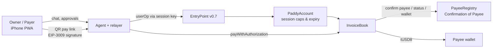

# Paddy: an AI payments clerk with on-chain guardrails

> Built for **Aevum Builder Challenge #1** (QDay · DoraHacks). Tracks: Invoice Payments · Confirmation of Payee · Native AI Assistants.
> Network: **QDay Aevum Testnet** (chain ID 44005), stablecoin **tUSD8**. Test tokens only.

"Paddy" is Naija slang for a trusted friend. Paddy lets a small business hand its payment paperwork to an AI clerk without handing over its money.

## The problem

African SMEs pay suppliers and staff and chase invoices over WhatsApp and bank apps. Two things hurt them:

1. **Wrong-account and invoice-redirection fraud**, the "we've changed our account details, pay this new account" message.
2. **No safe delegation.** Giving an assistant (human or AI) the power to pay means giving it the keys.

## The solution (target architecture)

| Layer | What it does | Status |
|---|---|---|
| `PayeeRegistry` | On-chain **Confirmation of Payee**, like a NIBSS name enquiry: wallet ↔ verified legal-name hash, time-limited attestations, suspension after fraud reports, two-step wallet changes with a "recently changed" warning, reputation counters (ERC-8004-inspired identity) | ✅ built + tested |
| `InvoiceBook` | tUSD8 invoices: direct or **gasless EIP-3009** payment bound to one invoice, partial payments, on-chain receipts, idempotent refs, capped fee snapshot, payments always go to the registry wallet, invoices **freeze if the payee's wallet changes** | ✅ built + tested |
| `PaddyAccount` + `SessionPolicyModule` | ERC-4337 (EntryPoint v0.7) smart account. The AI clerk gets a **session key** with payee allowlist, per-tx cap, daily cap, budget, expiry, instant revoke | ⏳ next |
| `PaddyPaymaster` + relayer | Sponsored gas, so the user never holds tQDAY | ⏳ |
| Agent service | Plain language → strict payment-intent JSON → policy pre-check → userOp, or owner approval. Invoice text is treated as data, never as instructions (prompt-injection safe) | ⏳ |
| Web app (PWA) | Owner console, agent chat, QR pay page, audit trail with explorer links | ⏳ |



## Core flows (contracts available today)

1. **Register and verify a payee.** The payee calls `register(displayName, NameHash.hash(legalName), metadataURI)`, and an attester checks documents off-chain and calls `verify(id, nameHash, validUntil)`.
2. **Confirmation of Payee.** Before paying, the app or agent calls `confirmPayeeByName(wallet, "Nkechi Foods Ltd")` and gets back `Match | NameMismatch | NotVerified | VerificationExpired | Suspended | NoRecord`, plus a `walletRecentlyChanged` warning.
3. **Invoice.** The payee calls `createInvoice(payer, amount, dueDate, ref, metadataHash, allowPartial)`.
4. **Pay.** Either `pay(id, amount)` after `approve`, or **gasless** `payWithAuthorization(...)` signed as tUSD8 `ReceiveWithAuthorization` with `nonce = authorizationNonce(id, from, amount, salt)`. A relayer can't redirect the signature to another invoice or change the amount.
5. **Receipt.** `PaymentReceived` / `InvoicePaid` events plus `getReceipt(id)`. Settlement updates the payee's on-time reputation.

### Safety properties (tested)
- Funds only ever go to the payee's **current registry wallet**, never to an address written inside the invoice text.
- **Suspended** payees can't issue invoices or be paid.
- A wallet change after issue **freezes** the invoice until the payee re-confirms it from the new wallet after the cooldown.
- EIP-3009 signatures are **bound** to invoice id, amount, payer and chain. Replay, tampering and expiry all revert.
- The contract **never holds funds**, which the invariant tests confirm.
- The fee is capped at 1% and snapshotted when the invoice is issued. Ownership transfers are two-step.

## Aevum integration

| Item | Value |
|---|---|
| Chain ID | 44005 (`0xABE5`) |
| RPC | https://rpc-test.qday.info |
| Explorer | https://explorer-test.qday.info (Blockscout) |
| tUSD8 | `0x456569838f1d43009A91ebA4263147Afd7233483` (6 decimals, EIP-2612 + EIP-3009, EIP-712 domain `tUSD8` / `2`) |
| EntryPoint v0.7 | `0x0000000071727De22E5E9d8BAf0edAc6f37da032` |
| PayeeRegistry | [`0x27f16054c035bc2450f5BABe2f63990dEc1D2E95`](https://explorer-test.qday.info/address/0x27f16054c035bc2450f5BABe2f63990dEc1D2E95) |
| InvoiceBook | [`0x2b4A256024A58Ff0B62eEf853c8682124c3D2c16`](https://explorer-test.qday.info/address/0x2b4A256024A58Ff0B62eEf853c8682124c3D2c16) |

## Live on Aevum Testnet (deployed Mon Nov 16, 2026)

| Contract | Address |
|---|---|
| PayeeRegistry | [`0x27f16054c035bc2450f5BABe2f63990dEc1D2E95`](https://explorer-test.qday.info/address/0x27f16054c035bc2450f5BABe2f63990dEc1D2E95) |
| InvoiceBook | [`0x2b4A256024A58Ff0B62eEf853c8682124c3D2c16`](https://explorer-test.qday.info/address/0x2b4A256024A58Ff0B62eEf853c8682124c3D2c16) |
| Deployer / demo attester / relayer (testnet only) | [`0xEFdB1c7144a36ca1B9F52447617e4880449Dfe14`](https://explorer-test.qday.info/address/0xEFdB1c7144a36ca1B9F52447617e4880449Dfe14) |
| Demo payee "Paddy Demo Foods Ltd" | [`0x0C9bce6c93765Ad41243141f936A4eA59A04272F`](https://explorer-test.qday.info/address/0x0C9bce6c93765Ad41243141f936A4eA59A04272F) |
| Demo buyer (holds 0 tQDAY) | [`0x3b2735C1A24433736e775c2da549F96CA7CA2f1b`](https://explorer-test.qday.info/address/0x3b2735C1A24433736e775c2da549F96CA7CA2f1b) |

Settings: wallet-change cooldown 3600 s, fee 30 bps paid to the deployer.

**Deployment transactions**

| Step | Tx |
|---|---|
| Deploy PayeeRegistry | [`0x4e6e4274…621334`](https://explorer-test.qday.info/tx/0x4e6e42741a9750d64f0e8de8ca0433ee8f5cbcd3ea8818fae454869d52621334) |
| Deploy InvoiceBook | [`0xedc87dd1…284407`](https://explorer-test.qday.info/tx/0xedc87dd120c31e8ed9445e2d894b354997fe87266b23e372083623f74d284407) |
| registry.setReporter(InvoiceBook) | [`0x202ed895…933d42`](https://explorer-test.qday.info/tx/0x202ed8958d9f915a7446dcc34a5586417a0848de4f895dd1b576f75e29933d42) |
| registry.setAttester(deployer) | [`0xf95c665f…d9c6cc`](https://explorer-test.qday.info/tx/0xf95c665fb1a09d61cc943dc846a94c7aa3e5a3f2a60a2417d9ca9c71e4d9c6cc) |
| book.setFee(30 bps) | [`0x2b4b899a…b0ea61`](https://explorer-test.qday.info/tx/0x2b4b899a594c24cf8f699055cd561bb596bc8338058de8b56e52a73b5fb0ea61) |

**Live smoke test** (`script/SmokeTest.s.sol`): register → verify → invoice → gasless payment with the real tUSD8

| Step | Tx |
|---|---|
| Deployer sends 0.02 tQDAY gas to the demo payee | [`0xd3618281…05b55c`](https://explorer-test.qday.info/tx/0xd3618281dccf6a15925d8c0d803f61b91a8c0b21a74adb129c577a285a05b55c) |
| Deployer sends 0.15 tUSD8 to the demo buyer (buyer gets NO gas) | [`0x39b1985e…4220da`](https://explorer-test.qday.info/tx/0x39b1985e5b56cda0f70e577164350fe7fb9751f0b57fcb575e02f1839d4220da) |
| Payee registers "Paddy Demo Foods Ltd" (payeeId 1) | [`0x27a182b8…800e20`](https://explorer-test.qday.info/tx/0x27a182b8c157b1cb3d514acc87baf6802f23e5516cac15a9749f726358800e20) |
| Attester verifies payee for 180 days | [`0xf784fc90…efe61d`](https://explorer-test.qday.info/tx/0xf784fc9068aefa937ef9821fd379250dbf0d592789b432514c1fc958adefe61d) |
| Payee issues invoice #1 for 0.1 tUSD8 to the buyer | [`0x603d0430…a21cbe`](https://explorer-test.qday.info/tx/0x603d0430e86b9d77972a441155ef29eeeb5d891aede2561dea9a973fcea21cbe) |
| Relayer settles invoice #1 with the buyer's EIP-3009 signature (gasless, receipt #1) | [`0x3a224f20…0cef6c`](https://explorer-test.qday.info/tx/0x3a224f203a2150a5bc9882a1db352522fbc793863617881f1aa85a78460cef6c) |

What happened on-chain: invoice #1 is `Paid` (0.1 tUSD8). Receipt #1 shows the payee received 0.0997 tUSD8 and the protocol fee was 0.0003 tUSD8. The buyer never held any gas. `confirmPayeeByName(payee, "Paddy Demo Foods Ltd")` → `Match`.

**Source verification:** explorer-test.qday.info accepts verification requests but currently has **0 verified contracts in total**, QDay's own tUSD8 and faucet included, and our submissions come back as "Unable to verify". Until that's fixed, anyone can confirm the deployed bytecode matches this repo:

```bash
forge build && python3 tools/check-bytecode.py   # PayeeRegistry MATCH, InvoiceBook MATCH
```

## Run it

```bash
# prerequisites: Foundry (https://getfoundry.sh)
git clone <repo> && cd paddy
forge install            # forge-std, openzeppelin-contracts v5.1.0
forge test               # unit + fuzz + invariant tests
AEVUM_FORK=true forge test --mc AevumForkTest -vv   # gasless payment against the REAL tUSD8 on an Aevum fork
forge coverage --ir-minimum --report summary

# deploy to Aevum Testnet (throwaway testnet key, funded from https://faucet.qday.info/en)
cp .env.example .env     # fill PRIVATE_KEY; never commit it
source .env
forge script script/Deploy.s.sol --rpc-url aevum --broadcast --private-key $PRIVATE_KEY \
  --verify --verifier blockscout --verifier-url https://explorer-test.qday.info/api

# live smoke test (needs PAYEE_PRIVATE_KEY and BUYER_PRIVATE_KEY testnet keys, plus REGISTRY and BOOK)
forge script script/SmokeTest.s.sol --rpc-url aevum --broadcast --slow
```

### Environment variables
| Var | Meaning |
|---|---|
| `PRIVATE_KEY` | Testnet-only deployer key |
| `RPC_URL` | Aevum RPC |
| `WALLET_CHANGE_COOLDOWN` | Seconds a wallet change stays flagged and invoices stay frozen (default 3600 on testnet; 72h recommended in production) |
| `FEE_BPS` | Protocol fee on settled invoices (default 30 = 0.3%, max 100) |

## Repository layout
```
src/
  PayeeRegistry.sol          Confirmation of Payee + reputation
  InvoiceBook.sol            invoices, gasless payments, receipts
  interfaces/                IPayeeRegistry, IEIP3009
  libraries/NameHash.sol     canonical legal-name hashing
test/                        unit, fuzz and invariant tests (MockUSD8 mirrors tUSD8)
test/fork/                   Aevum fork test against the live tUSD8 contract
script/Deploy.s.sol          Aevum deployment
script/SmokeTest.s.sol       live end-to-end smoke test (register, verify, invoice, gasless pay)
tools/check-bytecode.py      deployed-bytecode match check
broadcast/                   Foundry deployment and smoke-test records for chain 44005
```

## Known limitations
- Name matching on-chain is exact after normalisation (letters and digits, lower-case). Fuzzy "close match" hints will run off-chain in the agent.
- Attesters are trusted. On testnet the deployer is the demo attester; production would use licensed KYB partners.
- QDay's own bundler, paymaster and SDK aren't published for testnet yet, so Paddy ships its own (next milestone).

## Roadmap
- [ ] Session-key smart account + paymaster (ERC-4337 v0.7)
- [ ] Agent service with an injection-resistant intent pipeline
- [ ] PWA: owner console, chat, QR pay page, audit trail
- [ ] `@paddy/guardrails` TypeScript package (NameHash, CoP lookup, EIP-3009 helpers)
- [ ] Mainnet (QDay Q1 2027): swap in QDay's paymaster, bundler and SDK; hybrid ML-DSA owner keys when the Phase-2 precompiles land

## Business model
A 0.3% fee on settled invoices (on-chain, capped at 1%), a paid SME tier (more sessions, team roles, accounting export), and attestation partnerships with cooperatives and KYB providers.

## License
MIT
