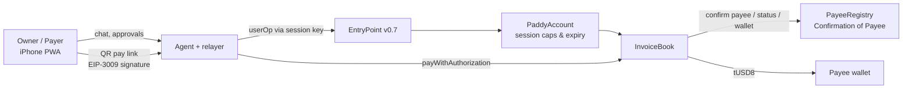

# Paddy: an AI payments clerk with on-chain guardrails

> Built for **Aevum Builder Challenge #1** (QDay · DoraHacks). Tracks: Invoice Payments · Confirmation of Payee · Native AI Assistants.
> Network: **QDay Aevum Testnet** (chain ID 44005), stablecoin **tUSD8**. Test tokens only.

"Paddy" is Naija slang for a trusted friend. Paddy lets a small business hand its payment paperwork to an AI clerk without handing over its money.

## The problem

African SMEs pay suppliers and staff and chase invoices over WhatsApp and bank apps. Two things hurt them:

1. **Wrong-account and invoice-redirection fraud**, the "we've changed our account details, pay this new account" message.
2. **No safe delegation.** Giving an assistant (human or AI) the power to pay means giving it the keys.

## The solution (target architecture)

| Layer | What it does | Status |
|---|---|---|
| `PayeeRegistry` | On-chain **Confirmation of Payee**, like a NIBSS name enquiry: wallet ↔ verified legal-name hash, time-limited attestations, suspension after fraud reports, two-step wallet changes with a "recently changed" warning, reputation counters (ERC-8004-inspired identity) | ✅ built + tested |
| `InvoiceBook` | tUSD8 invoices: direct or **gasless EIP-3009** payment bound to one invoice, partial payments, on-chain receipts, idempotent refs, capped fee snapshot, payments always go to the registry wallet, invoices **freeze if the payee's wallet changes** | ✅ built + tested |
| `PaddyAccount` + `SessionPolicyModule` | ERC-4337 (EntryPoint v0.7) smart account. The AI clerk gets a **session key** with payee allowlist, per-tx cap, daily cap, budget, expiry, instant revoke | ⏳ next |
| `PaddyPaymaster` + relayer | Sponsored gas, so the user never holds tQDAY | ⏳ |
| Agent service | Plain language → strict payment-intent JSON → policy pre-check → userOp, or owner approval. Invoice text is treated as data, never as instructions (prompt-injection safe) | ⏳ |
| Web app (PWA) | Owner console, agent chat, QR pay page, audit trail with explorer links | ⏳ |



## Core flows (contracts available today)

1. **Register and verify a payee.** The payee calls `register(displayName, NameHash.hash(legalName), metadataURI)`, and an attester checks documents off-chain and calls `verify(id, nameHash, validUntil)`.
2. **Confirmation of Payee.** Before paying, the app or agent calls `confirmPayeeByName(wallet, "Nkechi Foods Ltd")` and gets back `Match | NameMismatch | NotVerified | VerificationExpired | Suspended | NoRecord`, plus a `walletRecentlyChanged` warning.
3. **Invoice.** The payee calls `createInvoice(payer, amount, dueDate, ref, metadataHash, allowPartial)`.
4. **Pay.** Either `pay(id, amount)` after `approve`, or **gasless** `payWithAuthorization(...)` signed as tUSD8 `ReceiveWithAuthorization` with `nonce = authorizationNonce(id, from, amount, salt)`. A relayer can't redirect the signature to another invoice or change the amount.
5. **Receipt.** `PaymentReceived` / `InvoicePaid` events plus `getReceipt(id)`. Settlement updates the payee's on-time reputation.

### Safety properties (tested)
- Funds only ever go to the payee's **current registry wallet**, never to an address written inside the invoice text.
- **Suspended** payees can't issue invoices or be paid.
- A wallet change after issue **freezes** the invoice until the payee re-confirms it from the new wallet after the cooldown.
- EIP-3009 signatures are **bound** to invoice id, amount, payer and chain. Replay, tampering and expiry all revert.
- The contract **never holds funds**, which the invariant tests confirm.
- The fee is capped at 1% and snapshotted when the invoice is issued. Ownership transfers are two-step.

## Aevum integration

| Item | Value |
|---|---|
| Chain ID | 44005 (`0xABE5`) |
| RPC | https://rpc-test.qday.info |
| Explorer | https://explorer-test.qday.info (Blockscout) |
| tUSD8 | `0x456569838f1d43009A91ebA4263147Afd7233483` (6 decimals, EIP-2612 + EIP-3009, EIP-712 domain `tUSD8` / `2`) |
| EntryPoint v0.7 | `0x0000000071727De22E5E9d8BAf0edAc6f37da032` |
| PayeeRegistry | _TBD after deploy_ |
| InvoiceBook | _TBD after deploy_ |

## Run it

```bash
# prerequisites: Foundry (https://getfoundry.sh)
git clone <repo> && cd paddy
forge install            # forge-std, openzeppelin-contracts v5.1.0
forge test               # unit + fuzz + invariant tests
AEVUM_FORK=true forge test --mc AevumForkTest -vv   # gasless payment against the REAL tUSD8 on an Aevum fork
forge coverage --ir-minimum --report summary

# deploy to Aevum Testnet (throwaway testnet key, funded from https://faucet.qday.info/en)
cp .env.example .env     # fill PRIVATE_KEY; never commit it
source .env
forge script script/Deploy.s.sol --rpc-url aevum --broadcast --private-key $PRIVATE_KEY \
  --verify --verifier blockscout --verifier-url https://explorer-test.qday.info/api
```

### Environment variables
| Var | Meaning |
|---|---|
| `PRIVATE_KEY` | Testnet-only deployer key |
| `RPC_URL` | Aevum RPC |
| `WALLET_CHANGE_COOLDOWN` | Seconds a wallet change stays flagged and invoices stay frozen (default 3600 on testnet; 72h recommended in production) |
| `FEE_BPS` | Protocol fee on settled invoices (default 30 = 0.3%, max 100) |

## Repository layout
```
src/
  PayeeRegistry.sol          Confirmation of Payee + reputation
  InvoiceBook.sol            invoices, gasless payments, receipts
  interfaces/                IPayeeRegistry, IEIP3009
  libraries/NameHash.sol     canonical legal-name hashing
test/                        unit, fuzz and invariant tests (MockUSD8 mirrors tUSD8)
test/fork/                   Aevum fork test against the live tUSD8 contract
script/Deploy.s.sol          Aevum deployment
```

## Known limitations
- Name matching on-chain is exact after normalisation (letters and digits, lower-case). Fuzzy "close match" hints will run off-chain in the agent.
- Attesters are trusted. On testnet the deployer is the demo attester; production would use licensed KYB partners.
- QDay's own bundler, paymaster and SDK aren't published for testnet yet, so Paddy ships its own (next milestone).

## Roadmap
- [ ] Session-key smart account + paymaster (ERC-4337 v0.7)
- [ ] Agent service with an injection-resistant intent pipeline
- [ ] PWA: owner console, chat, QR pay page, audit trail
- [ ] `@paddy/guardrails` TypeScript package (NameHash, CoP lookup, EIP-3009 helpers)
- [ ] Mainnet (QDay Q1 2027): swap in QDay's paymaster, bundler and SDK; hybrid ML-DSA owner keys when the Phase-2 precompiles land

## Business model
A 0.3% fee on settled invoices (on-chain, capped at 1%), a paid SME tier (more sessions, team roles, accounting export), and attestation partnerships with cooperatives and KYB providers.

## License
MIT
